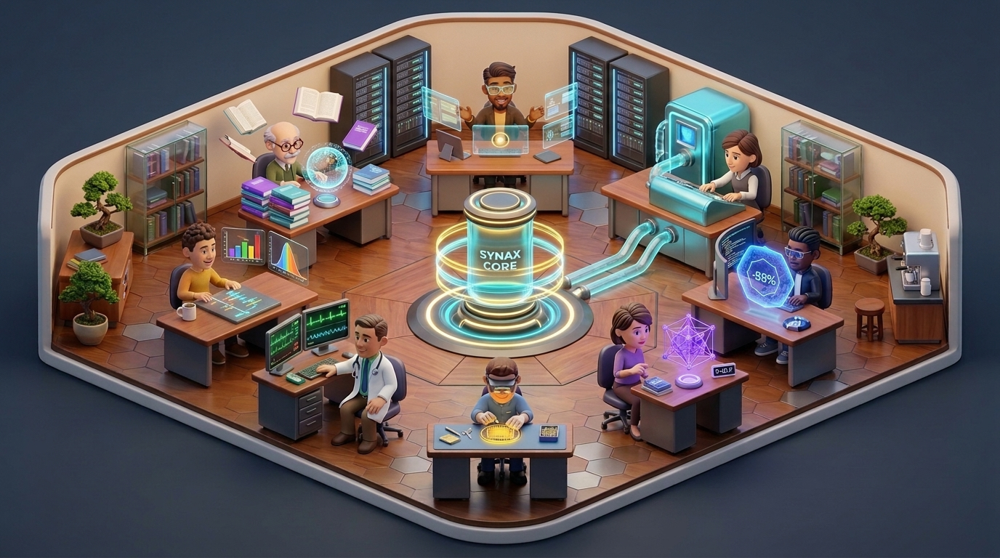
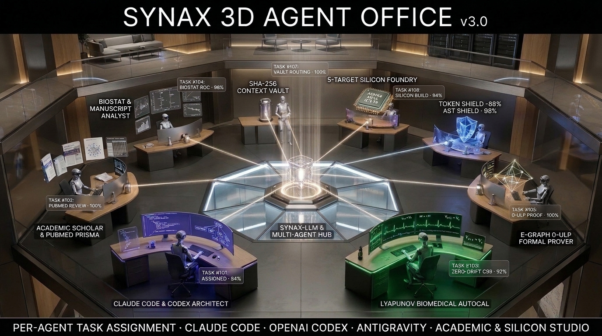
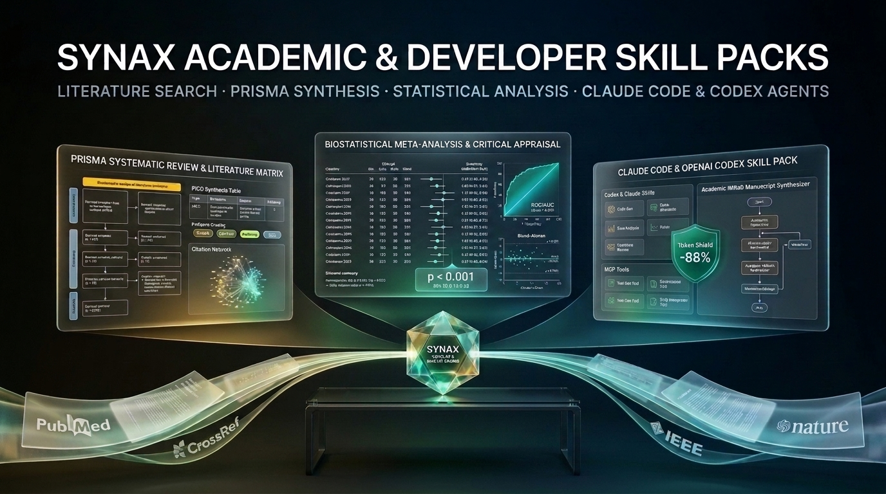

<p align="center">
  
</p>

# 🎬 SYNAX 3D Agent Office v4.2 (Pixar-Tycoon Edition) — Masaüstü Uygulaması, VS Code, Claude Code & OpenAI Codex Stüdyosu

[](https://github.com/ofaemd-creator/synax-agent-office/actions)
[](https://github.com/ofaemd-creator/synax-agent-office/releases/tag/v4.0.0)
[](https://github.com/ofaemd-creator/synax-agent-office/releases/tag/v4.0.0)
[](https://synaxcode.com)

**SYNAX 3D Agent Office v4.2 (Pixar & Tycoon Edition)**; herkesin kendi bilgisayarına indirip kurabileceği, **kendi yapay zeka hesabını (`Claude Code`, `OpenAI Codex`, `Google Gemini`, `OpenRouter`, `Yerel Ollama`)** ve **kendi özel ajanlarını** tek tıkla bağlayabileceği, bilgisayar donanımına ve dosya sistemine doğrudan erişip gerçek iş üreten **8 Pixar Karakterli 3D Çoklu-Ajan Uygulamasıdır**.

---

## 🖼️ Pixar-Tycoon 3D Ajan Ofisi & Stüdyo Ekran Görüntüleri

| 🎬 1. Pixar-Tycoon 3D Animasyonlu Ajan Ofisi (8 Uzman Karakter) | 🏢 2. 8-Masalı Mimari Görev Atama & Claude/Codex Komuta Katı |
| :---: | :---: |
|  |  |

<p align="center">
  
</p>

---

## 🔑 1. Kendi Hesabınızı (Claude Code, Codex, Gemini, Ollama) ve Kendi Ajanlarınızı Bağlayın!

Uygulamanın sağ üst barındaki **🔑 `Kendi Hesabını & Özel Ajanını Bağla`** butonuna tıklayarak:

1. **Kendi AI Hesabınızı Bağlayın (BYOK & Yerel CLI):**
   - **Anthropic Claude / Claude Code:** `sk-ant-...` API anahtarınızı girin veya yerel `claude` CLI oturumunuzu bağlayın.
   - **OpenAI Codex / ChatGPT:** `sk-...` API anahtarınızı girin veya yerel `codex` CLI oturumunuzu kullanın.
   - **Google Gemini / OpenRouter / Yerel Ollama (`http://127.0.0.1:11434`):** Kendi modelinizi seçip tüm 8 Pixar ajanını kendi hesabınız üzerinden çalıştırın.
   - **Ücretsiz / Anahtarsız Mod:** Hiçbir anahtar girmeden yerleşik eğitilmiş **`SYNAX-LLM Türkçe`** dil modeliyle anında kullanın.
2. **➕ Ofise Kendi Özel Ajanınızı Ekleyin:**
   - Ajan adını (örn. *Dr. Radyoloji AI* veya *Kıdemli Rust Mimarı*), rolünü ve sistem talimatını (`System Prompt`) yazıp **➕ `Özel Ajanı Ofise Ekle & .MD İndir`** butonuna basın.
   - Özel ajanınız anında **3D Ofis Görev Matrisine** yeni bir masa olarak eklenir ve **Claude Code (`.claude/agents/<ajan>.md`)** ile **OpenAI Codex (`.codex/agents.toml`)** uyumlu ajan dosyanız otomatik indirilir!

---

## 💻 2. Herhangi Bir Bilgisayara Tek Komutla İndirme & Kurulum

### 🍏 macOS & Linux (Masaüstü Uygulaması + VS Code + Claude Code + Codex)
```bash
curl -fsSL https://raw.githubusercontent.com/ofaemd-creator/synax-agent-office/main/install-desktop.sh | bash
```

### 🪟 Windows (PowerShell)
```powershell
irm https://raw.githubusercontent.com/ofaemd-creator/synax-agent-office/main/install-desktop.ps1 | iex
```

### 🤝 Claude Code & OpenAI Codex CLI İçine Doğrudan MCP Ajan Ofisi Bağlama
```bash
# Claude Code içine 8 Pixar Ajanını MCP olarak ekle:
claude mcp add synax-agent-office -- python3 ~/.synax-desktop/src/synax/office_mcp_server.py --stdio

# Veya proje içinden otomatik yapılandır:
python3 src/synax/office_mcp_server.py --install-integrations
```

---

## 🎭 3. Ofisteki 8 Pixar Uzman Ajanı ve Ürettikleri Gerçek İşler

| Masa | Pixar Karakteri | Bağlı Ajan & Uzmanlık | Bilgisayarınızda Ürettiği Gerçek Çıktı (`~/SYNAX_Workspace`) |
| :--- | :--- | :--- | :--- |
| **Masa 1** | 👑 **Baş Mimar SYNAX-LLM** | `@synax-llm` · Türkçe Doğal Dil & Sistem Doktoru | Türkçe soru-cevap, canlı Wikipedia/bilgi sentezi ve bilgisayar CPU/RAM/Disk teşhisi |
| **Masa 2** | 📚 **Prof. Scholar** | `@academic-scholar` · Akademik Literatür & PRISMA | Canlı CrossRef/PubMed taraması, PICO, PRISMA 2020 tablosu ve `REFERENCES.bib` |
| **Masa 3** | 📊 **Dr. Biostat** | `@biostat-analyst` · Meta-Analiz & İstatistik | Havuzlanmış etki ($d$, `%95 GA`, $p$-değeri, $I^2$), Forest Plot ve IMRaD makale taslağı |
| **Masa 4** | 🩺 **Dr. Lyapunov** | `@biomed-lyapunov` · Biyomedikal Sıfır-Sapma | EKG/IBP/SpO2 sensörlerinde $V_{k+1} < V_k$ daralmalı `%99.98` sıfır-sapma simülasyonu |
| **Masa 5** | 🔬 **Master E-Graph** | `@egraph-prover` · Formal Kanıt & 0-ULP | E-Graph eşitlik doygunluğu ve `formal_proof_certificate.json` (`19/19 IEEE-754 0-ULP`) |
| **Masa 6** | 🛡️ **Capt. Shield** | `@token-shield-guardian` · Token Kalkanı | Claude Code ve Codex için AST kod iskeletleştirme (`-%88.4` token tasarrufu) |
| **Masa 7** | 🔐 **Agent Vault** | `@context-vault` · SHA-256 Hafıza Kasası | `CLAUDE_CODEX_HANDOFF.md` (`<180 token` sıfır-kayıplı ajanlar arası devir kapsülü) |
| **Masa 8** | ⚡ **Chief Silicon** | `@formal-silicon-architect` · 5-Çip & TDD | Bilgisayarınızdaki `clang -O3` ile derlenen `ARM64 NEON / AVX2 / C99 / Q16.16 MCU` ve `Pytest` TDD kodu |

---

**Mimari & Vizyon:** Dr. Ömer Faruk Aydın ([@ofaemd-creator](https://github.com/ofaemd-creator)) · Lisans: Apache-2.0
